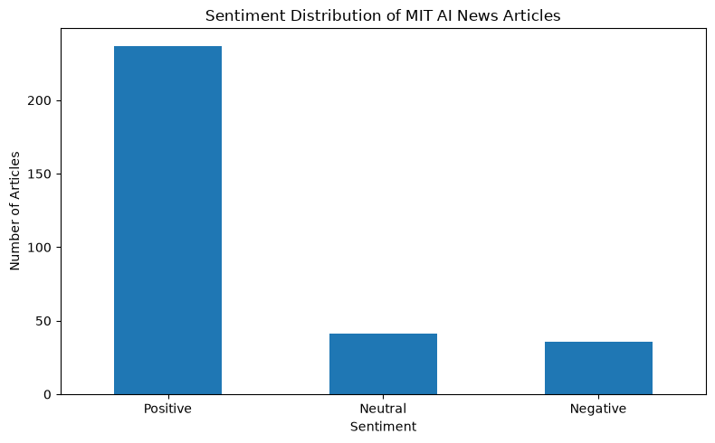
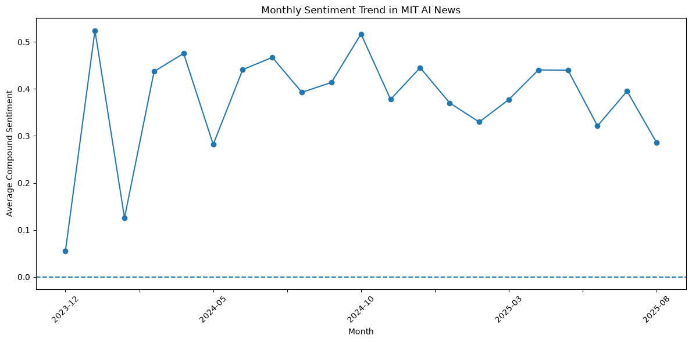
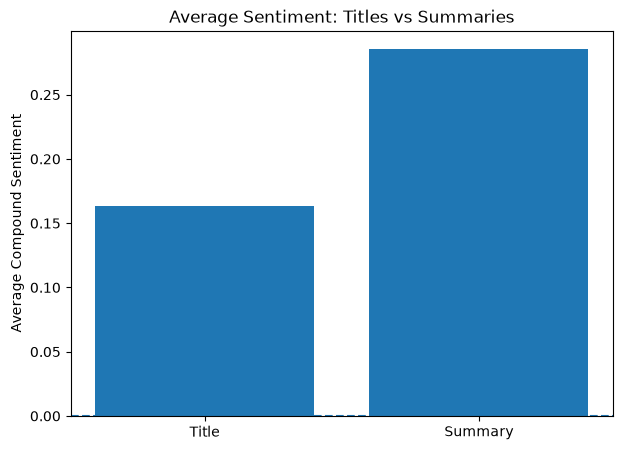
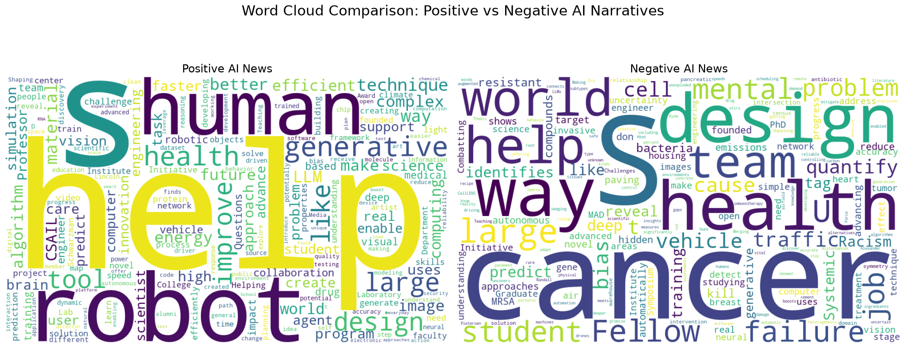

# MIT AI News Sentiment Analysis

Exploratory natural language processing of 314 MIT News articles using VADER, keyword frequencies, and visualizations.

## Overview

This project examines the tone of AI-related news in a supplied MIT News article dataset. It scores each article's **title and summary**, explores sentiment over time, compares headline and summary tone, and visualizes common words and phrases.

VADER is a lexicon- and rule-based sentiment analyzer. This project applies an existing analyzer; it does not train a supervised machine-learning classifier. Scikit-learn is used for text frequency analysis, not model training.

## Dataset

The supplied `MIT_AI_ARTICLES.csv` contains **314 articles**, dated **20 December 2023–19 August 2025**. Its ten original columns include two exported index columns, which the notebook removes. The remaining fields are `title`, `author`, `publication_date`, `datetime`, `summary`, `body`, `paper_link`, and `url`.

The CSV has no empty values, duplicate titles, or duplicate article URLs. Some paper links are placeholders rather than valid URLs. Full article bodies are available but are **not included in sentiment scoring**. Collection and sampling procedures are not documented in the supplied files. See [dataset notes](data/README.md) for schema and redistribution considerations.

## Analysis workflow

1. Inspect dataset dimensions, missing values, and duplicates; remove exported indices.
2. Parse UTC timestamps and derive calendar year and month.
3. Join stripped titles and summaries with a period and space. Preserve punctuation and capitalization for VADER. The compatibility column `clean_text` contains this same text; it is not an aggressively cleaned corpus.
4. Compute negative, neutral, positive, and compound VADER scores. Label compound scores **Positive ≥ 0.05**, **Negative ≤ −0.05**, and **Neutral otherwise**.
5. Summarize sentiment distributions and yearly/monthly means alongside article counts.
6. Rank high- and low-scoring articles and compare titles with summaries scored separately.
7. Use `CountVectorizer` for sentiment-group word frequencies and corpus bigrams; generate word clouds with additional domain stop words.

A reproducible 30-article sample (`random_state=42`) is displayed for inspection. No human reference labels or completed manual validation are supplied, so accuracy, precision, recall, and F1 are not reported.

## Results

The following values come from executing the repaired notebook in order:

| VADER label | Articles | Share |
| --- | ---: | ---: |
| Positive | 237 | 75.48% |
| Neutral | 41 | 13.06% |
| Negative | 36 | 11.46% |

- Mean compound sentiment is **0.3875**; the median is **0.4404**. Most title–summary pairs receive positive VADER labels in this sample.
- Summaries have a higher mean compound score (**0.2853**) than titles (**0.1634**). This is a descriptive difference; no significance test is performed.
- Annual mean scores are **0.0545** (2023, **4** articles), **0.4059** (2024, **179** articles), and **0.3725** (2025, **131** articles). The sparse 2023 sample and partial-year coverage prevent strong claims about a long-term trend.
- Negative labels require contextual review. For example, “From steel engineering to ovarian tumor research” receives **−0.7906**, illustrating how disease-related wording can contribute to a negative score without implying an anti-AI stance.









Word frequencies describe this corpus; raw counts across unequal sentiment groups do not establish which words are disproportionately associated with a group. Word clouds are exploratory displays, not formal topic models or evidence of causation.

## Limitations

This single-source institutional news sample is not representative of public opinion or all AI coverage. Text sentiment does not directly measure public trust, perceived safety, or attitudes toward AI. VADER is not validated here against human annotations and can misread scientific language, negation, and context. Date coverage and monthly sample sizes vary. No causal or statistically significant change is claimed.


## Run

From the repository root, create and activate a Python virtual environment, then run:

```bash
python -m pip install -r requirements.txt
python -m nltk.downloader vader_lexicon
python -m jupyterlab
```

Open `notebooks/mit_ai_news_sentiment.ipynb`, select the environment's Python kernel, and run all cells in order. The notebook locates the CSV from either the repository root or the `notebooks/` directory. The first VADER lexicon download requires internet access. Dependencies are listed without version pins; this is not a locked environment.


## Possible extensions

- Manually annotate a sample and evaluate agreement with VADER.
- Compare title–summary scores with full-body scoring.
- Normalize keyword frequencies before comparing sentiment groups.
- Document collection criteria and add additional news sources.
